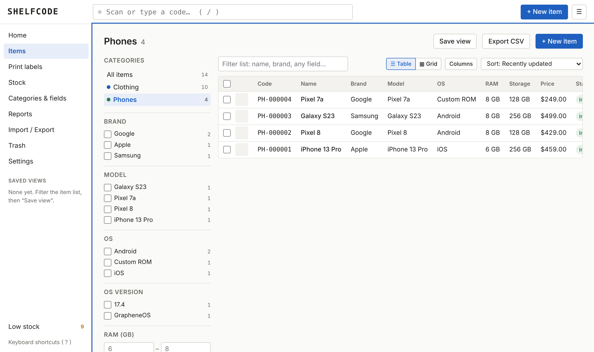
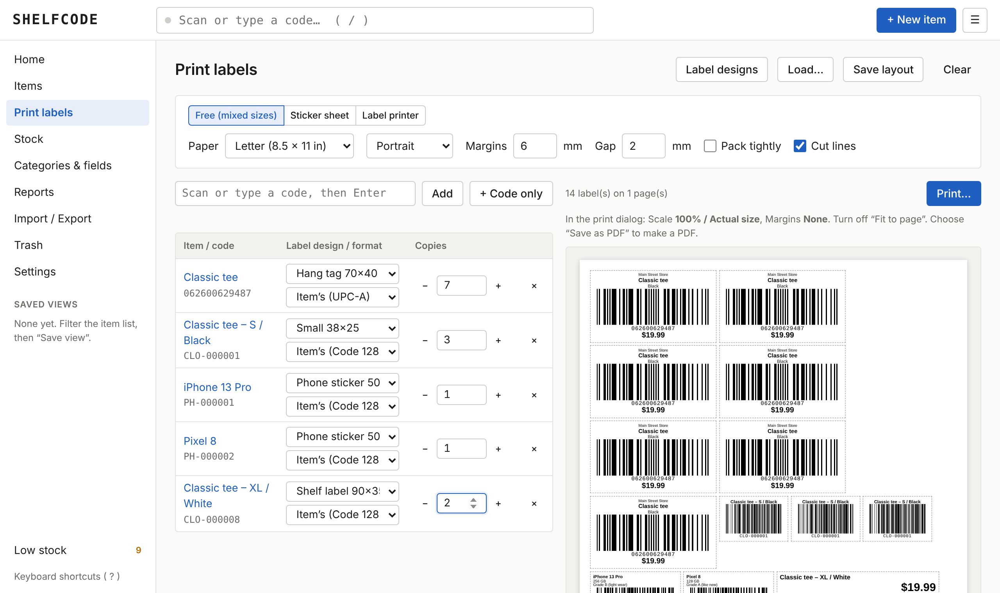

# Shelf-Code

**SHELFCODE** is a free, open-source, self-hosted barcode database for any kind of store or collection: clothing, phones, books, parts, anything.

It is one program. Start it, and a simple window shows your addresses while the app runs in your browser, on this PC and on any phone, tablet or PC on the same network. Your database, photos and backups stay in one folder next to the program. Nothing goes to the cloud.



## Features

- **Strict code lookup.** Scan or type a code. If it exactly matches an item, the item opens. If not, nothing happens. Extra codes (manufacturer UPC/EAN, serial) and "scannable" fields like IMEI or ISBN also work.
- **Make it fit anything.** Categories and sub-categories, each with its own fields: text, number with unit, money, dropdown, ordered sizes, multiple choice, yes/no, date, colour, link, identifier, and age computed from a date. Starter templates for Clothing, Phones, Electronics, Books, Shoes, Jewelry, Tools & Parts, and General.
- **Rich items.** Photos (drag, drop or paste), price, cost and margin, quantity, status, location, supplier, tags, description, and private notes.
- **Print any mix of barcodes on one page.** For example 7 × code A as large hang tags, 3 × code B as small stickers, and 2 shelf labels, all on one sheet. Three print modes:
  - **Free:** mixed sizes, packed automatically.
  - **Sticker sheet:** Avery-style sheets. Click a cell to skip labels already used.
  - **Label printer:** Dymo, Zebra, Brother and similar.
- **Label designer.** Choose the size and what each label shows: name, price, any field, store name, photo, and the barcode.
- **Barcode formats:** Code 128, Code 39, Code 93, EAN-13, UPC-A, EAN-8, ITF-14, QR Code and Data Matrix. Check digits are validated, and codes are never changed behind your back: leading zeros stay.
- **Scanners.**
  - Any USB or Bluetooth scanner works on every page.
  - Built-in connector for the [Barcode Scanner](https://barcode-scanner.abelly99.workers.dev) phone app: scans go straight into SHELFCODE, with no typing app needed.
- **Browse.** Category tree, filters generated from your fields, multi-column sort, table or photo grid, your choice of columns, and saved views.
- **Bulk actions.** Print labels, change any field (prices by %), add or remove tags, export, or move to Trash.
- **Stock.** Sell, receive, quick-sell mode (each scan sells 1), stock count with a missing/extra report, and full history per item.
- **Variants.** Turn one item into sizes × colours in one step, each with its own code.
- **Import/Export:** CSV with column mapping and a dry run, JSON export, and Excel-safe codes.
- **Automatic updates.** Every time SHELFCODE starts or restarts, it installs the newest release from GitHub. The download is checked first, and if anything goes wrong the current version keeps running. You can turn this off in Settings → About.
- **Safe data.** Automatic daily backups, a backup before every import or restore, one-click restore, a Trash with undo, and an activity log.
- **Other devices.** Use it from any phone or tablet on your Wi-Fi, with an optional PIN.
- **Reports, dark mode and keyboard shortcuts.**



## Install

| Where | How | Guide |
|---|---|---|
| **Windows PC** | Download [`SHELFCODE.exe`](https://github.com/ABelly99/Shelf-Code/releases/latest/download/SHELFCODE.exe), put it in an empty folder, double-click | below |
| **Linux server** | `curl -fsSL https://github.com/ABelly99/Shelf-Code/releases/latest/download/install.sh \| sudo bash` | [docs/linux.md](docs/linux.md) |
| **Debian / Ubuntu / Fedora** | `.deb` / `.rpm` from the [latest release](https://github.com/ABelly99/Shelf-Code/releases/latest) | [docs/linux.md](docs/linux.md) |
| **ZimaOS / CasaOS** | App Store → **+** → Custom Install → import [`shelfcode-zimaos.yml`](https://github.com/ABelly99/Shelf-Code/releases/latest/download/shelfcode-zimaos.yml) | [docs/zimaos.md](docs/zimaos.md) |
| **Docker** | `docker run -d -p 8765:8765 -v shelfcode-data:/data ghcr.io/abelly99/shelf-code` | [docs/docker.md](docs/docker.md) |

Then open `http://<that-machine>:8765` in a browser.

### Windows

1. Make an empty folder, for example `Documents\SHELFCODE`, and put [`SHELFCODE.exe`](https://github.com/ABelly99/Shelf-Code/releases/latest/download/SHELFCODE.exe) in it.
2. Double-click **SHELFCODE.exe**. On first start it sets everything up by itself:
   - a data folder with the database, photos and backups
   - a desktop shortcut
   - then your browser opens SHELFCODE
3. Pick what you sell (Clothing, Phones, …) and add your first item with **+ New item**.

Keep the black window open while you use SHELFCODE. Closing it stops the app. Starting it again while it is already running just opens your browser.

**Updates:** each time you start SHELFCODE, it checks for a new version and installs it by itself. Your data stays where it is.

On first start, Windows may ask two things:
- **"Windows protected your PC":** click *More info → Run anyway*. The program is not code-signed.
- **Firewall:** allow *Private networks*, so phones and tablets on your Wi-Fi can connect.

### Use it on a phone or tablet

When SHELFCODE starts, the window shows your PC's local IP:

```
  On this PC:        http://localhost:8765
  Other devices:     http://192.168.1.23:8765  (Wi-Fi)
```

Open the "Other devices" address on any device on the same Wi-Fi. Type `ip` in the window to show it again. You can set a PIN for other devices in **Settings → Network**.

### Connect the phone scanner

1. On your phone, open the [Barcode Scanner](https://barcode-scanner.abelly99.workers.dev) site, tap **Scan**, and open the **Drawer** to see the connecting code (for example `K7P2-QX9M-4TZR`).
2. In the SHELFCODE window, type `connect K7P2-QX9M-4TZR`, or enter the code in **Settings → Scanner**.

The dot in the search box turns green when your phone is connected. SHELFCODE reconnects by itself every time it starts. Close Barcode Typer while SHELFCODE is connected.

Scans go to the SHELFCODE page you used last. In most places, a scan opens the item. On **Print labels** it adds the item to the print list, and in **Stock** it adds the item to the current list.

### Printing tips

In the browser's print dialog, choose **Scale 100% / Actual size** and **Margins: None**. Choose **Save as PDF** to get a PDF. If labels come out slightly shifted, print the test page from **Settings → Printing** and enter the correction there.

### Commands in the window

| Command | What it does |
|---|---|
| `open` | open SHELFCODE in the browser |
| `ip` | show the addresses for this PC and other devices |
| `status` | items, open pages, scanner status |
| `connect <code>` | connect the phone scanner |
| `disconnect` | stop receiving phone scans |
| `site <address>` | use a different scanner website |
| `scan <code>` | send a test scan to the open page |
| `backup` | make a backup now |
| `quit` | stop SHELFCODE |

Start options: `--port 9000`, `--no-browser`, `--local-only` (only this PC), `--data D:\ShopData`. `--headless` runs it as a server. `shelfcode --help` lists every option.

### Your data

On Windows, everything is stored in `SHELFCODE-data` next to the program (on a Linux server: `/var/lib/shelfcode`; on ZimaOS: `/DATA/AppData/shelfcode`):

```
SHELFCODE/
├── SHELFCODE.exe
└── SHELFCODE-data/
    ├── READ-ME.txt      what's in this folder
    ├── shelfcode.db     SQLite database
    ├── images/          item photos
    └── backups/         daily .zip backups (database + photos)
```

To move to another PC, copy the whole folder. **Settings → Backup** can make, download and restore backups, and copy them to a second folder such as OneDrive or a USB drive.

## Build from source

You need [Go](https://go.dev/dl/) 1.21 or newer (it downloads the exact Go version it needs). Nothing else is required: the web interface, templates and barcode library are built into the program.

```bash
git clone https://github.com/ABelly99/Shelf-Code.git
```

```bash
cd Shelf-Code
```

Windows program (from any OS):

```bash
GOOS=windows GOARCH=amd64 go build -trimpath -ldflags "-s -w" -o SHELFCODE.exe .
```

For the computer you are on (Windows, macOS or Linux):

```bash
go build -o shelfcode .
```

All release files (Windows `.exe` with version info, Linux tarballs, `.deb`/`.rpm`, ZimaOS files, checksums) go into `dist/`:

```bash
./scripts/release.sh 1.0.0
```

Publishing a release on GitHub with a tag like `v1.0.0` makes GitHub Actions build all of these, attach them to the release, and push the Docker image to `ghcr.io/abelly99/shelf-code`.

SHELFCODE is made for Windows, and the same code also runs on macOS and Linux. On Linux and macOS it runs as a server (no console window) when started without a terminal, or with `--headless`.

### Project layout

| Path | What it is |
|---|---|
| `main.go`, `console*.go` | start-up, the window, network addresses, commands |
| `server.go` | web server, routes, LAN access and PIN |
| `db.go` | SQLite schema, settings, default label designs |
| `items.go` | items, the strict code lookup, code generation, filters and sorting, variants, bulk edits |
| `catalog.go` | categories, custom fields, templates, label designs, print layouts and saved views |
| `stock.go` | stock movements, activity, dashboard and reports |
| `importexport.go` | CSV import/export, JSON export |
| `backup.go` | backups and restore |
| `scanner.go`, `events.go` | phone-scanner relay connector, and pushing scans to open pages |
| `media.go` | photos |
| `shortcut_*.go` | desktop shortcut on first start (Windows) |
| `templates/` | starter categories (JSON) |
| `web/` | the browser app (plain HTML, CSS and JavaScript, no build step) |
| `packaging/` | Linux service, installer and package scripts, Windows icon |
| `deploy/` | Docker Compose and ZimaOS app files |
| `Dockerfile`, `scripts/release.sh`, `.github/workflows/` | how releases and the Docker image are built |

## License

SHELFCODE is released under [CC0 1.0 Universal](LICENSE) (public domain). Barcodes are drawn with [bwip-js](https://github.com/metafloor/bwip-js) (MIT licence), included in `web/vendor/`.
